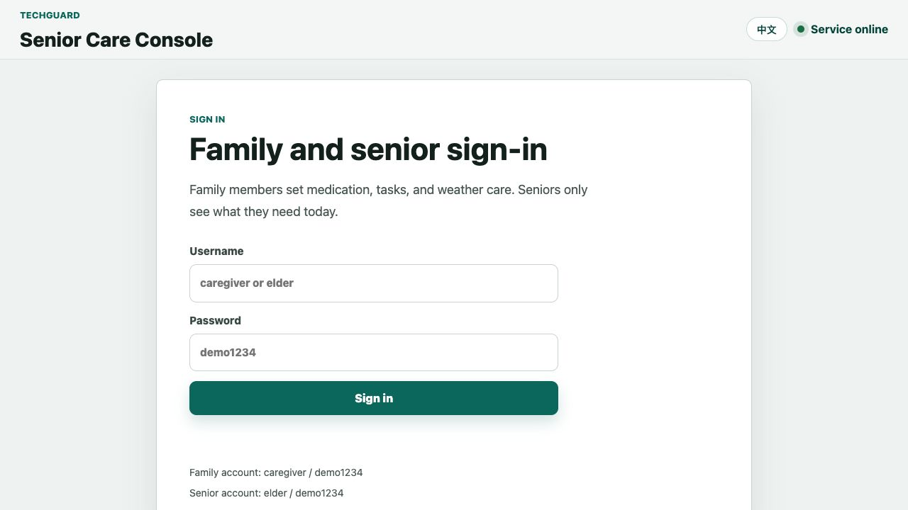

# TechGuard Senior Care Console

TechGuard Senior Care Console is a multi-agent care application for older adults living independently and the family members who support them. It provides two separated experiences: seniors get a simple daily workspace for reminders, fraud checks, health records, and travel help, while caregivers can configure medication schedules, tasks, weather care, travel plans, and Feishu group notifications.

The highlight is its practical multi-agent workflow. A medication agent manages medicine reminders, a task agent tracks family assignments, a fraud-protection agent checks suspicious SMS messages, a health agent reviews blood pressure and checkup reports, a travel agent gives senior-friendly route advice, and a notification agent sends important events to the family care group. Together, these agents turn scattered care needs into clear, timely, and trackable actions.

TechGuard aims to make technology warmer and easier for seniors. It helps reduce digital anxiety, improves family care coordination, and gives older adults more confidence when facing daily health, travel, and online safety situations.

Full English documentation: [README_EN.md](README_EN.md)

English app URL:

```text
/?lang=en
```



## 长辈端：今天要做的事

长辈端首屏只有一张「今天要做的事」清单，把吃药、家人交办的任务、量血压按时间合成一条流水：

- 每条显示时间、要做什么、以及「早已超时 / 现在该做 / 还有 X 小时」三种状态；超时未确认的条目用红色左边框高亮。
- 做完点一下大按钮即可确认，家属端实时可见。
- 前几天一直没做完的事折叠在「前几天还没做的（N 项）」里，不会把今天的安排挤出屏幕。
- 首屏常驻求助条：红色「一键联系家人」用于紧急情况，白色「我没事，报个平安」用于主动打消家属顾虑（同一天只记一条，不会刷屏）。
- 天气关怀文本直接显示在清单下方。
- **「读给我听」**：点一下会用语音把今天的安排念出来（现在是几号、一共几件事、每件事几点做什么、哪些超时了）。给视力不好、或者看字慢的长辈用。防骗结论和出行建议也各有一个朗读按钮。朗读语速放慢到 0.88 倍，用的是浏览器自带语音，不需要联网服务。
- **字号三档**：标准 / 大 / 特大，选完记在本地，下次打开还是这个字号。整页字号和按钮高度一起缩放，不是只放大正文。

长辈端整体使用更大的字号、更大的点击区（按钮 ≥56px）、并在小屏把导航改成固定 4 列网格，不需要左右滑动找菜单。

## 求助条：三种不同强度的动作

长辈端首屏常驻一条求助条，三个按钮对应三种真实场景：

| 按钮 | 用途 | 依赖 |
| --- | --- | --- |
| 🔴 **一键联系家人** | 身体不舒服、摔倒、有人催您转钱 | 记录到告警中心 + 飞书群 |
| ☎️ **打电话给家人** | 需要马上有人接电话 | 家属在「提醒配置 → 我的联系电话」里填号码后出现，点一下直接拨号 |
| ⚪ **我没事，报个平安** | 主动打消家人顾虑 | 飞书群收到一张平安卡片，同一天只记一条 |

「打电话给家人」这个按钮存在的理由：飞书没配好时，「一键联系家人」只是把消息记进应用，家人不一定马上看到。**真正出事的时候，能打通电话才是最可靠的**。家属没填号码时这个按钮不显示，避免点了没反应。

## 一个家属照护多位长辈

如果同时要照顾两位老人（比如爸妈都在），家属端顶部会出现「正在照护」选择器，切换后所有页面（提醒配置、健康档案、任务、告警）都跟着切到那位长辈。选择会持久化，不用每次登录重选。

演示库里预置了 `elder` 和 `elder2` 两位长辈挂在你名下，用来体验切换；`elder2` 是空状态，正好可以看到没有计划时长什么样。

## 复诊摘要（可打印）

家属带长辈去医院时，最难的是**把数据拿出来**——医生问「最近血压怎么样、在吃什么药、有没有漏服」，只能举着手机在屏幕上翻。

「复诊摘要」把这些聚合成一张医生能直接看的纸，一键打印或另存为 PDF：

1. **当前用药**——全部用药计划，含已停用的（标注「已停用」）
2. **血压记录**——区间内次数、平均血压、异常次数、最近一次、总体判断与建议，附最近 20 条明细
3. **用药完成情况**——应服总次数、已确认、漏服、完成率，以及漏服明细
4. **身体不适记录**——长辈自己报的「不舒服」类记录
5. **体检报告要点**——区间内的报告摘要

打印时会自动隐藏导航、按钮和其它模块，只输出摘要本身；表格行做了分页保护，不会被切成两半。统计范围可选 7 / 30 / 90 / 180 天。

接口 `GET /api/visit-summary?days=30` 只返回结构化字段，**不会把体检报告的原图（base64）带进响应**——那会把响应撑到几 MB。

## 生活记录：老人说一句，就真的记下来了

长辈端「生活事件记录」里，老人可以直接说或写一句今天做了什么，例如「我今天早上八点半吃过降压药了」。系统会解析成结构化记录：

- **自动分类**：吃药 / 吃饭 / 睡觉 / 出门 / 身体不适 / 心情 / 其他
- **自动推断时间**：把「早上八点半」「下午两点」「刚吃完午饭」这类口语时间转成 `08:30` / `14:00` / `12:00`；**推断不出来就如实留空，不会瞎猜成当前时间**
- **四个快捷按钮**：我吃过药了 / 我吃过饭了 / 我出去走走 / 我不舒服——老人打字慢，点一下比打字快

分类用关键词加口语化正则（比如「出去买了点菜」不含「买菜」也要能识别成出门），推断时间是纯规则的中文时间解析，**不依赖任何 AI 服务或网络**。

**「我有点不舒服」会自动通知家属**：写入告警中心并推送到飞书群。这是这个模块最有价值的一条——老人主动说身体不舒服，家属第一时间知道。

家属端「照护记录」能查看全部生活记录（含记录方式：语音/手写），可以删除记错的条目，但不能替长辈编造记录。下面另有一张「今日概览」表，汇总吃药、任务、血压、体检、天气的完成情况。

## 家属端：提醒的修改与停用
「提醒配置」里的吃药计划和「任务安排」里的任务现在都有 **编辑 / 停用 / 删除**：

- **编辑**：药名、时间、剂量、任务名称和日期时间都能改，改完立即生效。
- **停用**：不再提醒，但**保留历史记录**。老人停药就该用这个——已经吃过的记录不会消失，日报和漏服统计也不会因为停用而抹掉历史。
- **删除**：连同该计划的历史记录一起移除，操作前有确认提示。

已停用的计划在列表里会置灰标注「已停用」，方便随时重新启用。家属端和长辈端看到的提醒始终是同一份数据，改完不用重新登录。

## 手机提醒（Web Push）

这是「提醒老人吃药」真正生效的前提——**开启后手机不用停在这个页面，到点会直接弹出系统通知**。

### 怎么开

1. **安卓**：用 Chrome 打开应用 → 点长辈端「开启手机提醒」→ 允许通知。
2. **苹果手机**：必须先「添加到主屏幕」（Safari 底部分享按钮 → 添加到主屏幕），**从桌面图标打开应用**，再点「开启手机提醒」。iOS 只允许已安装到桌面的网页推送，普通 Safari 标签页拿不到权限。
3. 前提是页面必须是 **HTTPS**（`localhost` / `127.0.0.1` 除外）。http 页面浏览器不会给推送权限。

未开启时，长辈端今日待办顶部会常驻一条橙色提示，说明「到点不会响」，点它即可开启。

### 会收到什么

| 时机 | 通知内容 |
| --- | --- |
| 用药到点 | 「该吃药了：现在 08:00，请服用降压药。饭后一片」 |
| 超过 30 分钟仍未确认 | 「药还没确认：降压药还没有确认，记得点一下『我已吃药』」 |
| 任务到点 | 「任务提醒：现在该做：下午量血压」 |

同一剂药的多次提醒共用同一个通知 `tag`，通知栏不会堆一叠。点通知会回到应用。

### 配置 VAPID 密钥

Web Push 需要一对 VAPID 密钥。**本地开发不用配**——首次启动会自动生成并存进数据库。但生产环境请显式设置环境变量：

```bash
VAPID_PUBLIC_KEY="<web-push generateVAPIDKeys() 生成的公钥>"
VAPID_PRIVATE_KEY="<私钥>"
VAPID_SUBJECT="mailto:你@example.com"
```

不设置的话，换机器或清库会让老人手机上已保存的订阅**全部失效**（需要重新点一次「开启手机提醒」），启动日志里会有告警。

生成密钥：

```bash
node -e "console.log(require('web-push').generateVAPIDKeys())"
```

### 诚实的状态提示

「开启手机提醒」会如实报告失败原因，不会假装成功：HTTPS 缺失、浏览器不支持、iOS 未安装到桌面、服务端未配置密钥、通知权限被拒、浏览器连不上推送服务，各自有对应的中文说明。

## 体检指标趋势：这次比上次是好还是坏

体检报告以前只存一段文字摘要，回答不了医生最关心的问题——「上次血脂 5.8，这次 5.2，是好转了吗？」

家属在「健康档案 → 体检指标趋势」里照着报告录入关键数字（内置 11 项成人常见指标：空腹血糖、糖化血红蛋白、总胆固醇、甘油三酯、低密度/高密度脂蛋白、尿酸、肌酐、血钾、血钠、血红蛋白），应用给出：

- **最新值 + 环比变化**：`空腹血糖 6.8 mmol/L ↑ 0.6`，展开看迷你趋势图和每次的历史数值
- **参考范围判断**：超出范围的标红并排到最前；支持只有单侧界限的指标（总胆固醇只有上限、高密度脂蛋白只有下限）
- **未知指标不瞎判**：名字不在参考表里的，`参考范围` 显示为空，不做对错判断

两点刻意的设计：

- **不依赖任何 AI 服务**——数字由家属录入。没配 OpenAI key 也能用，而且比让模型从报告照片里猜数字更可靠。
- **参考范围是成人常用值，不是诊断依据**。界面上明确写了「请以报告上标注的范围为准」——不同医院、不同年龄段的参考区间不一样，这个判断只用来提示「这项值得关注」，不用来下结论。

## 药量管理：别让老人断药

高血压、糖尿病这类慢病老人**断药很危险**，而「妈，降压药还有没有？」几乎是每个照护家庭的固定对话。应用原来只知道「该吃药了」，不知道**还剩多少**。

在「提醒配置 → 药量管理」里登记每个药还剩多少片：

- 库存**按药名归集**——一天吃三次的药是三条计划但共用一盒药，所以只需要登记一次
- 长辈每确认一次吃药，库存**自动扣减**（减到 0 为止，不会变成负数）
- 快吃完时（默认剩余 ≤ 7 天）列表**标红并排到最前**，同时给家属发提醒：「碳酸钙D3片大约还能吃 4 天，记得去开药或补充」
- 同一个药每天最多提醒一次，不会刷屏
- 阈值可用 `MEDICATION_STOCK_ALERT_DAYS` 调整

**一个刻意的取舍**：老人吃了药但忘了点确认时，库存不会减，所以算出来是**偏多**的。宁可提醒晚一点，也不要误报缺药——反过来会让家属白跑一趟、进而不再信任提醒。

## 家属端：漏服可见

后端会把过期的未确认用药记录沉淀为 `missed` 状态，「告警中心」下方会显示最近 7 天的漏服明细（日期、时间、药品、剂量）。长辈通常不会主动报告漏吃药，这块是给家属看的。

吃药提醒支持一次选择多个用药时间（常用时间快捷按钮 + 自定义时间），保存时会为每个时间各建一条计划，不用反复填同一张表单。

## 演示账号

项目启动时会在账号不存在的情况下创建一组通用演示账号：

| 角色 | 登录名 | 密码 |
| --- | --- | --- |
| 家属端 | `caregiver` | `demo1234` |
| 长辈端 | `elder` | `demo1234` |
| 第二位长辈（用于体验照护切换） | `elder2` | `demo1234` |

这些账号仅用于本地演示。公开部署前请替换为正式认证方案，并修改默认密码。密码使用 `scrypt` + 每用户随机盐存储；如果数据库里是旧版 `sha256` 哈希，会在下次成功登录时自动升级，已存在的账号不会被启动流程重置密码。

## 本地运行

```bash
sh start-app.sh          # 推荐：前台运行，Ctrl+C 停止；可 PORT=8080 sh start-app.sh 换端口
```

> 如果你是在 AI 会话里让我起服务，注意那种进程属于会话的后台任务，**会在该轮结束时被回收**（日志里是 SIGTERM），表现为「刚才还能打开、过一会儿就连不上」。要让它常驻，请在你自己的终端里跑上面的命令。

```bash
PORT=5174 node server.mjs
```

打开浏览器访问：

```text
http://127.0.0.1:5174
```

英文界面：

```text
http://127.0.0.1:5174/?lang=en
```

局域网手机访问时，把 `127.0.0.1` 替换为电脑在同一 Wi-Fi 下的局域网地址。

## 可选配置

飞书机器人通知：

```bash
FEISHU_WEBHOOK_URL="https://open.feishu.cn/open-apis/bot/v2/hook/xxxx" PORT=5174 node server.mjs
```

线上定时提醒：

- `vercel.json` 已配置 `/api/cron/reminders` 每天扫描一次，以兼容 Vercel Hobby 计划。
- The current schedule `0 0 * * *` runs in UTC, which is 08:00 in Beijing time. It checks medication, tasks, and daily weather care, then records web alerts and sends Feishu group notifications.
- **建议线上一定要设置 `CRON_SECRET`**：设置后该接口必须带 `Authorization: Bearer $CRON_SECRET`；未设置时只接受本机回环地址或 `vercel-cron/*` 的请求，其余返回 403，启动时也会打印告警。
- **想要到点准时提醒，需要接外部调度器**：Vercel Hobby 限制 cron 每天只能跑一次，12:00 和 20:30 的药当天不会提醒。外部调度器每 5 分钟调用同一路径即可，接口本身是幂等的，不会重复打扰。飞书不能当调度器（它只负责投递），具体接法见 **[docs/scheduled-reminders.md](docs/scheduled-reminders.md)**。
- 提醒节奏：到点提醒一次 → 超过 30 分钟仍未确认升级提醒一次 → 之后静默；跨天后未确认的自动沉淀为漏服。阈值可用 `MEDICATION_ESCALATE_AFTER_MINUTES` 调整。

OpenAI 出行和体检报告分析：

```bash
OPENAI_API_KEY="你的 OpenAI API Key" PORT=5174 node server.mjs
```

AMap travel planning:

```bash
AMAP_WEB_SERVICE_KEY="your AMap Web Service Key" PORT=5174 node server.mjs
```

## 开发检查

```bash
node --check src/app.js
node --check server.mjs
node tests/core-smoke-test.js
```

## 重置演示数据

```bash
node scripts/seed-demo-data.mjs
```

脚本会**只重建演示范围内长辈的数据**（`user-elder` / `user-elder2`），所有日期相对「今天」生成，所以任何时候重跑，演示内容都是当下的（今天的任务、最近 14 天的血压、最近一周的用药记录）。

它会自动把原库备份成 `data/techguard.db.bak-<时间戳>`，并且**刻意不碰**这些内容：

- 已存在账号的**密码哈希**（不会把 scrypt 重置回旧的 sha256）
- `notification_channels`（里面是真实的飞书 webhook 配置）
- `push_subscriptions`（绑定在具体浏览器上，删了老人手机就收不到提醒）
- `notification_preferences`（用户的提醒开关）
- `app_settings`（VAPID 推送密钥）
- 家属填的**联系电话**

## 目录结构

| 文件 | 说明 |
| --- | --- |
| `index.html` | 应用主页面 |
| `src/styles.css` | 响应式界面样式 |
| `src/app.js` | 前端交互、角色界面和模块渲染 |
| `server.mjs` | Node 服务、SQLite API、飞书通知和 AI 调用 |
| `sw.js` | Service Worker：接收 Web Push 并弹系统通知 |
| `manifest.json` | PWA 清单（iOS 必须先「添加到主屏幕」才能收推送） |
| `icons/` | PWA 图标，由 `npm run generate:icons` 生成 |
| `docs/scheduled-reminders.md` | 外部定时调度器接入指南（cron-job.org / Cloudflare / Vercel Pro） |
| `tests/core-smoke-test.js` | 核心功能冒烟测试 |

## 提醒发给谁

提醒**不是**固定发给某一个账号，而是发给「**真正在照护这位长辈**的家属」——按 `family_links` 查找。**找不到关联家属时，只落库不外发**，并往服务端日志写一条告警。

没有关联家属的长辈（数据异常，正常流程下不会出现）以前会回落到默认演示账号，那意味着把这位长辈的血压、身体不适等敏感信息发给一个与 ta 毫无关系的家庭。宁可这条通知不外发，也不能发错人。

这一点在多家庭部署时很关键：早期版本把所有通知（吃药、天气、任务、血压、求助、缺药）都写死发给默认账号，A 家的老人提醒会发到 B 家去。站内通知和飞书推送现在都按这位长辈的家属逐个发送。

## 数据与隐私

- 本地 SQLite 数据库默认创建在 `data/techguard.db`，该文件已在 `.gitignore` 中排除。
- 静态文件服务使用白名单：只有 `index.html`、`src/*.js|css`、`sw.js`、`favicon.ico`、`docs/assets/` 下的图片可以被下载。`data/`、`server.mjs`、`package.json`、`node_modules/` 以及任何目录穿越请求（`..%2f` 等）一律返回 404。
- 飞书 Webhook 和 OpenAI Key 请通过环境变量配置，不要写入代码仓库。
- 体检报告照片和健康数据属于敏感信息，生产环境建议迁移到受控对象存储，并增加访问权限、加密和审计。
- 登录失败按「用户名 + IP」限流（5 次失败锁 5 分钟）；生产环境（`NODE_ENV=production` 或 `VERCEL`）的会话 Cookie 会带 `Secure`。

## 邀请家属：让家人自己加入

家属在「角色与权限」里填上关系（例如「女儿」），点「生成邀请链接」，把链接发给对方。对方打开链接、自己设置称呼、登录名和密码，就完成了——**不需要管理员代建账号，也不用把密码通过微信发出去**。

几个刻意的设计：

- **邀请 token 只在生成时显示一次**，数据库里只存 `sha256(token)`。即使库被拖走，里面的哈希也不能直接拿来用。
- **一次有效、7 天过期**。接受时用条件更新（`UPDATE ... WHERE used_at IS NULL`）保证并发下也只能成功一次，两个人同时点不会建出两个账号。
- **接受邀请不需要登录**（这正是它的用途），所以这个接口单独做了按 IP 的失败限流，防止被拿来刷用户名。
- **只能为「当前照护中的长辈」发邀请**，撤销时也校验归属——别的家属删不掉你的邀请，列表里也看不到。
- **列表接口不返回 token**，生成之后谁也再查不到，只能重新生成。

已知边界：用户名的唯一性检查在应用层（按小写比较），没有加 `LOWER(username)` 唯一索引——老库里若已存在大小写不同的同名账号，加索引会让启动直接失败。极端并发下（不同邀请、同一用户名）理论上仍可能建出两个账号。

## 数据来源：哪些是查到的，哪些是替代品

老人会相信应用说的话，所以「查到的」和「猜的」不该长得一样。每个会调用外部服务的地方都带 `source` 字段，界面据此区分：

| 能力 | 真实来源 | 拿不到时的行为 |
|---|---|---|
| 天气关怀 | `open-meteo`（实时） | `local-fallback`：**明说取不到**，并告诉老人「出门前自己看一眼窗外」；不再断言任何天气 |
| 出行路线 | `amap-transit`（实时导航） | `local-route-example`（演示用的固定路线）/ `local-fallback`（通用建议）/ `openai`（模型建议）——都不是实时导航 |
| 体检报告 | `openai` | `local-fallback`：明说「未启用图片分析，请让家人或医生核对」 |
| 血压判断 | 直接由真实读数计算，不是兜底 | — |

界面上（家属端）出现非实时来源时会显示一条橙色提示，例如「注意：这不是实时天气，是拿不到天气数据时的通用提醒」。

这一类问题修过两处，都是**把猜测讲成事实**：

- 天气拿不到时按城市名硬编码猜：上海/杭州/苏州/南京 一律「可能有雨」，其余一律「今天天气整体平稳」。跟当天真实天气毫无关系，而且和实时数据在界面上长得一模一样。
- 出行面板在完全没有天气信息时兜底成「天气平稳」。

另外地理编码对中文后缀敏感（「北京市」查不到、「北京」查得到），所以候选名会自动去掉「市/省」再试一次；但**绝不拿裸区名去查**——「朝阳」会命中辽宁省朝阳市，报成另一个城市的天气比查不到严重得多。

## 已知限制

- **服务端生成的建议文案目前只有中文**。血压判断（「偏高：这次数值偏高，建议安静休息 5 分钟后复测一次」）、诈骗识别的回复、天气关怀文案都是后端拼好的中文句子，切到英文界面时这部分仍是中文。界面骨架、按钮、指标名、复诊摘要的章节标题都已双语，但**服务端文案的双语还没做**。
- **第一位家属和长辈账号仍需在部署时创建**。「邀请家属」解决的是**后续**加入（女儿想拉上哥哥一起照护），首次搭建还是靠 `node scripts/seed-demo-data.mjs` 或直接写库——邀请的前提是已经有人能登录进去发邀请。
- 界面上原来有一个「姓名/关系/角色 + 添加成员」的表单，但它没有任何后端支持（点了不报错也不生效），已移除并换成真正的邀请流程。同样移除的还有「重置演示数据」按钮（它只写一行日志，真正的重置是靠 `node scripts/seed-demo-data.mjs`）。
- **参考范围是成人常用值**，只用来提示「这项值得关注」，不构成诊断依据；不同医院、不同年龄段的区间不一样，以报告上标注的为准。
